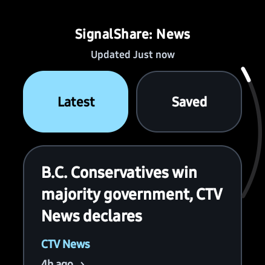

# SignalShare: News

A high-contrast news bulletin reader for Wear OS, with offline saved stories and a background Google News complication for compatible watchfaces.

**Open source under Apache-2.0.** The application code may be used commercially. The bundled Roboto font has its own SIL Open Font License; see [third-party notices](THIRD_PARTY_NOTICES.md).

<p>
  
  
</p>

## Features

- Latest headlines with publisher attribution and publication age.
- Tap a headline to open a bulletin and related coverage.
- Save bulletin snapshots in a separate offline reading list.
- Compact, high-contrast typography with an optional larger reading size and 48dp touch targets.
- Manual refresh, cached-feed status, native Back/swipe navigation, and rotary scrolling support.
- Open the complete story on a paired phone, or in a watch browser when available.
- Background complication data through `SHORT_TEXT`, `LONG_TEXT`, and `RANGED_VALUE`; compatible ticker faces receive a full headline and its measured width.
- Tapping a complication opens its matching cached bulletin.

Google News RSS supplies headlines and related coverage, rather than complete publisher article bodies. Complete reporting opens through the phone/browser action. This project is independent of Google and the news publishers; news content remains owned by its respective rights holders.

## Requirements

- Wear OS watch with Android API 33 or newer.
- Android SDK 36 and JDK 21 for development.
- Internet access for fresh headlines. Cached and saved bulletins remain available offline.
- A connected phone for the Read on phone action, or an installed watch browser for local web links.

The current feed is Canada / English. No account or API key is required.

## Build

Clone this repository, configure `ANDROID_HOME` for your SDK or add an ignored `local.properties` containing your `sdk.dir`, and use the included Gradle wrapper.

Windows PowerShell:

```powershell
.\gradlew.bat assembleDebug
```

macOS / Linux:

```sh
./gradlew assembleDebug
```

The APK is generated at `app/build/outputs/apk/debug/app-debug.apk`.

For unit tests and Android lint:

```sh
./gradlew testDebugUnitTest lintDebug
```

Install on an already paired watch using its serial from `adb devices -l`:

```sh
adb -s WATCH_SERIAL install --no-streaming -r app/build/outputs/apk/debug/app-debug.apk
```

Signing keys, local SDK paths and build output are deliberately excluded from Git. In-place updates require the same signing key as the existing installation.

## Watchface integration

Choose **SignalShare: News** as the complication source in a compatible face. Background fetching does not require the app to be visible. The source requests a persisted network job about every 15 minutes and selects a cached headline for each five-minute interval; Wear OS can defer updates.

The package remains `com.nocturne.news`, and the data source is `com.nocturne.news.NewsComplicationService`, to preserve existing installations and assigned complications. The launcher, reader and complication source use the SignalShare: News name.

The optional `RANGED_VALUE` ticker protocol uses the numeric value as text width in a 450-unit reference watchface, **not** as a percentage. `TEXT` contains the full headline, measured using the bundled Roboto font at size 17; the minimum viewport is 217 units. A compatible face supplies its own clipping and animation. An ordinary gauge should use a text data type instead. This repository contains the reader/provider app; it does not include the separate Nocturne watchface artwork or APK.

## Validation and current limits

Version 1.2.0 was built and installed on a Galaxy Watch8 Classic SM-L505F running API 36. Thirteen unit tests passed. Emulator and physical-watch instrumentation verified real background RSS fetching and reader navigation, saving, text-size preferences, exact headline taps and refresh scroll preservation. See [validation details](docs/VALIDATION.md).

Paired-phone browser delivery still needs an end-to-end user check. Hardware rotary input is implemented but was not physically turned during agent verification. Full article text is not scraped or generated.

## Google Play

The source can remain public while an official build is distributed for free or for a price on Google Play. This development build is not a published Play release. See [Play release preparation](docs/PLAY-STORE.md) for the remaining signing, privacy, content and review work.

## License and contributions

Application code is licensed under the [Apache License, Version 2.0](LICENSE). Third-party components retain their own licenses. Apache-2.0 does not grant trademark rights; forks should not imply that they are the official SignalShare distribution.

Bug reports and contributions are welcome through this repository's Issues and pull requests. See [CONTRIBUTING.md](CONTRIBUTING.md).
